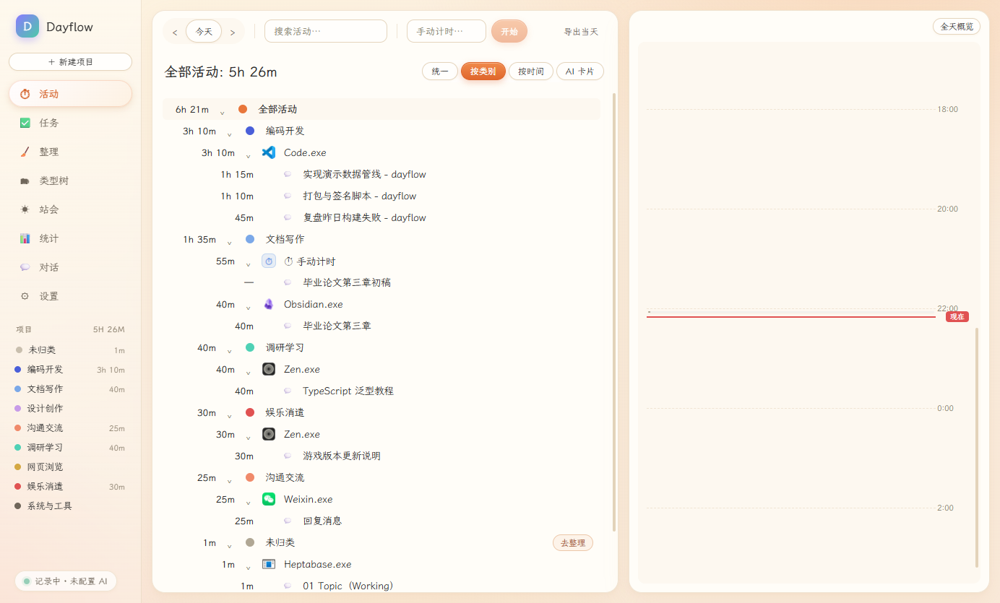
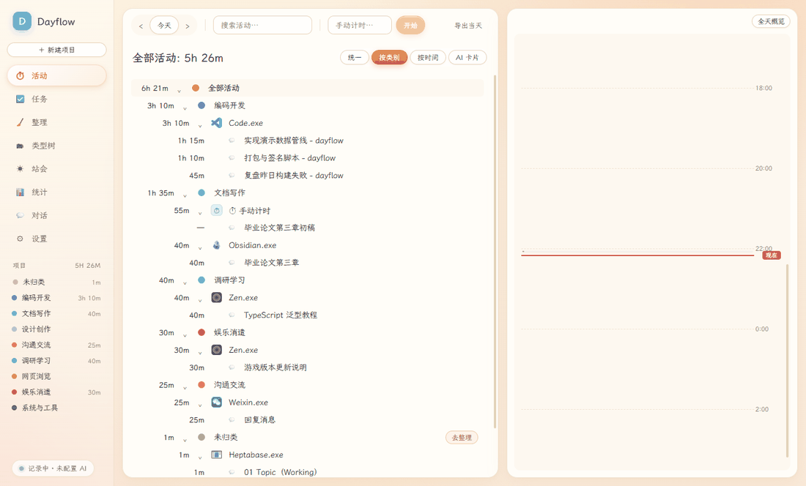
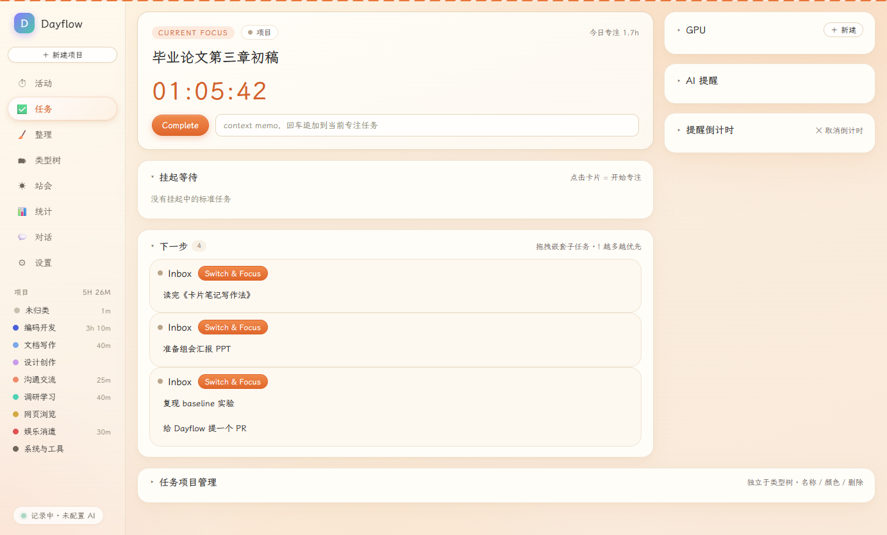
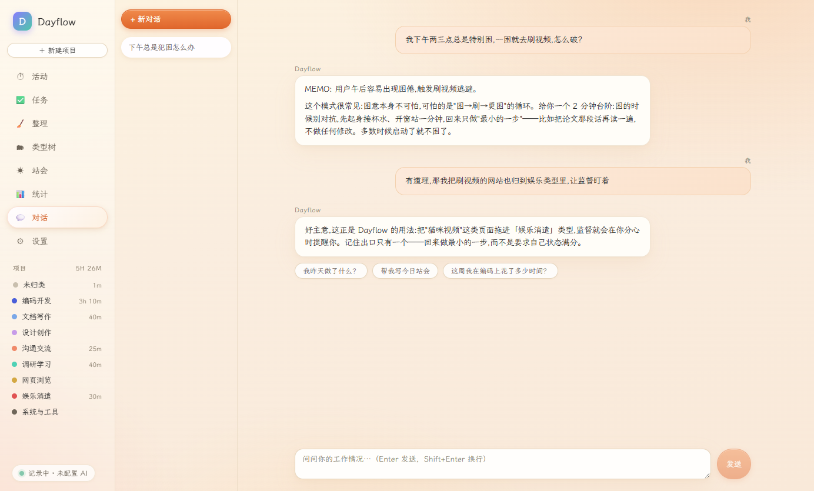
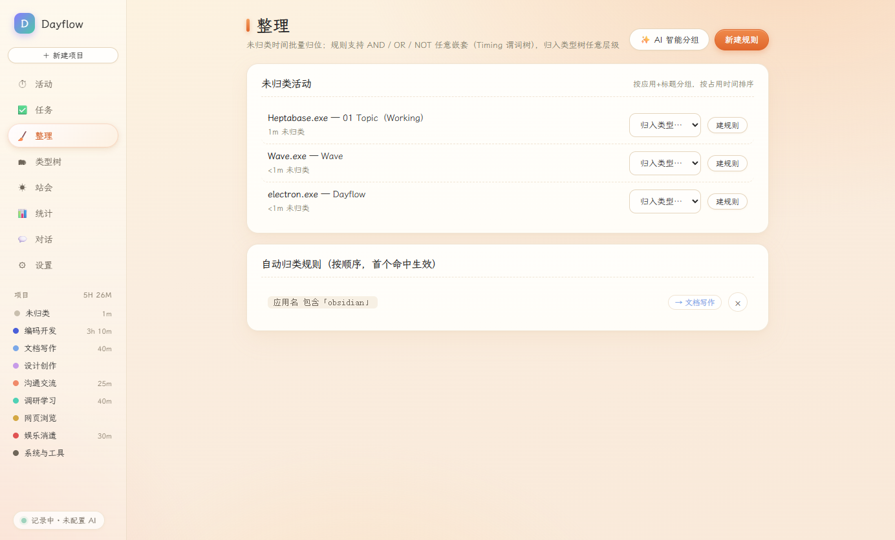
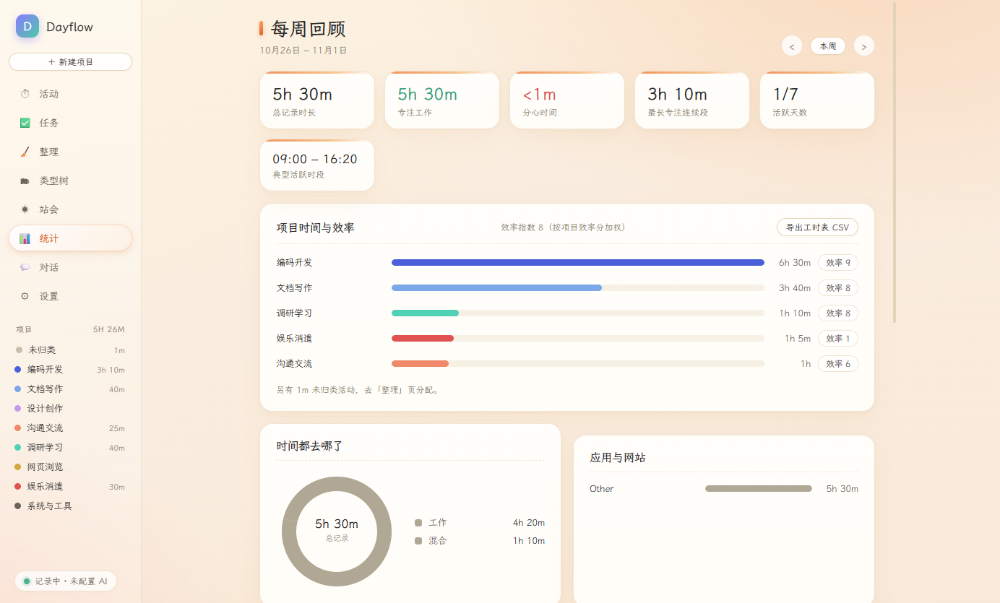

# Dayflow

[中文](README.md) | **English**

**Local-first screen time tracking with a learning-tutor agent.** Dayflow quietly records what you do on your computer and organizes it into your own category system. A built-in tutor agent — one that nags, reflects, and remembers your tasks — interrupts you on an escalating ladder when you drift: from a gentle desktop nudge all the way to a full-window blocking overlay.

A port of [JerryZLiu/Dayflow](https://github.com/JerryZLiu/Dayflow) (macOS) built on Electron, with an EpochToDo-style task system folded in.

> **Currently Windows 10/11 only.** On macOS, use the [original Dayflow](https://github.com/JerryZLiu/Dayflow). The core architecture (Electron + React + sql.js + AI pipeline) is cross-platform; porting to another OS mainly means swapping the foreground-tracking / window-geometry / browser-history layers (see `src/main/foreground.ts`, `windows-poll.ts`, `browser-history.ts`).



## Demo



> All images above are generated from **fictional seed data** (pipeline in `tools/demo/`, fully reproducible). No real user data is included.

| | |
|---|---|
|  |  |
| **Task system**: current focus timer, next-up queue, GPU/AI reminders | **Tutor chat**: long-term memory + full in-app context |
|  |  |
| **Review**: bulk-triage untracked time, AI-drafted rules with human sign-off | **Stats**: focus/distraction trends |

## Features

### Tracking & classification
- **Window activity tracking**: foreground app/title polled every 2 s into SQLite; AFK spans are flagged and excluded from study time; screenshots as a secondary signal (default 30 s, configurable)
- **AI cards**: every 15 minutes, window activity is condensed into readable cards (distractions flagged)
- **Three-tier classification**: user rule engine (arbitrarily nested AND/OR/NOT over app name / window title / **URL**) → learned memory (same page title reuses its category) → site hints; **browsers are classified per page, never by the whole exe**
- **Drag to classify**: drag from the activity tree/timeline onto a category to create a rule; Alt+drag builds an "app equals + title contains" rule in one step
- **AI review**: unclassified activities are clustered into themed groups and drafted into rules — nothing is written until you check each rule off

### Task system (EpochToDo)
- Current focus timer, waiting list, next-up queue (Switch & Focus)
- Pomodoro: earn break balance by studying, withdraw by ratio, cooldown between breaks
- Session compliance ratio (screenshots judge "were you actually doing this task")
- **Realtime two-way sync** with Obsidian Markdown

### Supervision (anti-escape)
- Escalation ladder: gentle desktop notification (deferrable once) → **blocking overlay** covering the violating window's content area, following the window in real time, showing the covered page's title and URL live
- Configurable exits: minimize/close the target (browsers close only the tab), earned breaks, "stop for today" — each can be disabled
- Session prompt: on app launch or return from AFK, asks "start studying now?" with an optional N-minute grace period

### Tutor agent
- **Memory + full context**: beyond long-term memory (ai-memory sidecar), chat and periodic reflection read real in-app data — task list, running timer, focus history, pomodoro balance, activity digest, current foreground
- A background reflection every 10 minutes distills recent activity/dialogue/tasks into long-term memory and refreshes the standing nudge (zero LLM at interrupt time)

### Privacy
- Everything stays in `%APPDATA%\Dayflow`; pick a local model for a fully offline setup
- Private apps (password managers by default): screenshot replaced with a gray placeholder, title hidden
- Incognito browser pages never resolve to a URL (history matching skips them by design)

## Getting started

```bash
npm install
npm run fetch-ai-memory   # download the ai-memory sidecar (Rust, local embeddings)
npm run dev               # development mode
npm run dist              # build the Windows installer → release-build/
```

Requirements: Node 20+, Windows 10/11. No screen-recording permission needed. Configure an AI provider on first launch.

## AI providers

| Provider | Notes |
| --- | --- |
| Gemini | Google AI Studio key, defaults to `gemini-2.5-flash` |
| ChatGPT | OpenAI key (`gpt-4o-mini`+) |
| Claude | Anthropic key |
| Zhipu GLM | Pay-as-you-go API, or **GLM Coding Plan** subscription (Anthropic-compatible gateway) |
| Xiaomi MiMo | Pay-as-you-go API, or Token Plan subscription |
| Ollama / LM Studio | Local models, **fully offline** |
| OpenAI-compatible | Any endpoint (vLLM, OpenRouter…) |

Timeline analysis requires a vision model; use "Test connection" in Settings.

## How it works

1. **Capture** — window polling (2 s) records the foreground app/title; screenshots grab all monitors and stitch them into one panorama JPEG (private apps → gray placeholder; locked/idle/paused → skipped)
2. **Batching** — pending frames close into a batch after 15 minutes (or 90 frames, or 3 minutes of quiet); gaps > 2 min split batches
3. **Analysis** — one-step timeline prompt + previous cards (45-min draft lookback) + clock-labeled frames → your provider; returned cards are anchored to the batch window
4. **Failure backoff** — analysis failures back off exponentially (60 s → 10 min); frames are kept and retried; any day can be reprocessed
5. **Classification** — rule engine first; browsers subdivided by page title/URL; LLM verdicts for never-seen apps

```
%APPDATA%\Dayflow\
  data\dayflow.db          # SQLite: activities/cards/tasks/chats/settings (in-memory + batched flush)
  recordings\YYYY-MM-DD\   # screenshot frames
```

## Reproduce the demo images

```bash
node tools/demo/seed.mjs init   # launch once on an empty data root to create the schema
node tools/demo/seed.mjs seed   # pour in fictional data
node tools/demo/shoot.mjs       # launch the app and screenshot every page → docs/images/
```

## License

MIT, same as upstream [JerryZLiu/Dayflow](https://github.com/JerryZLiu/Dayflow). See [LICENSE](LICENSE).
